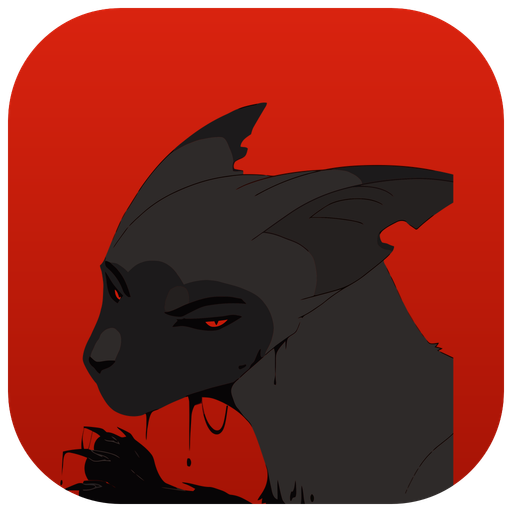
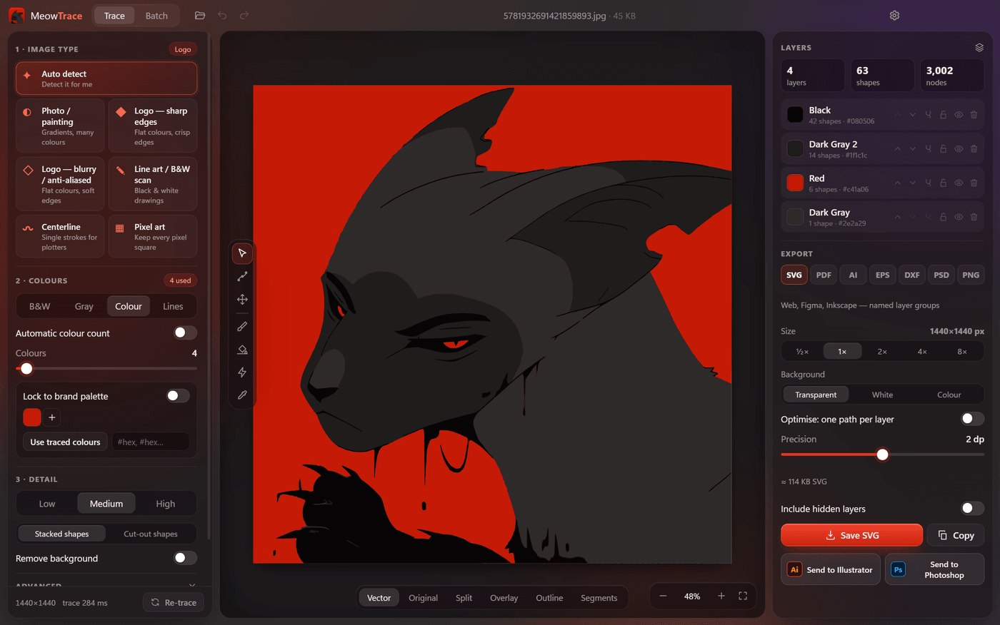
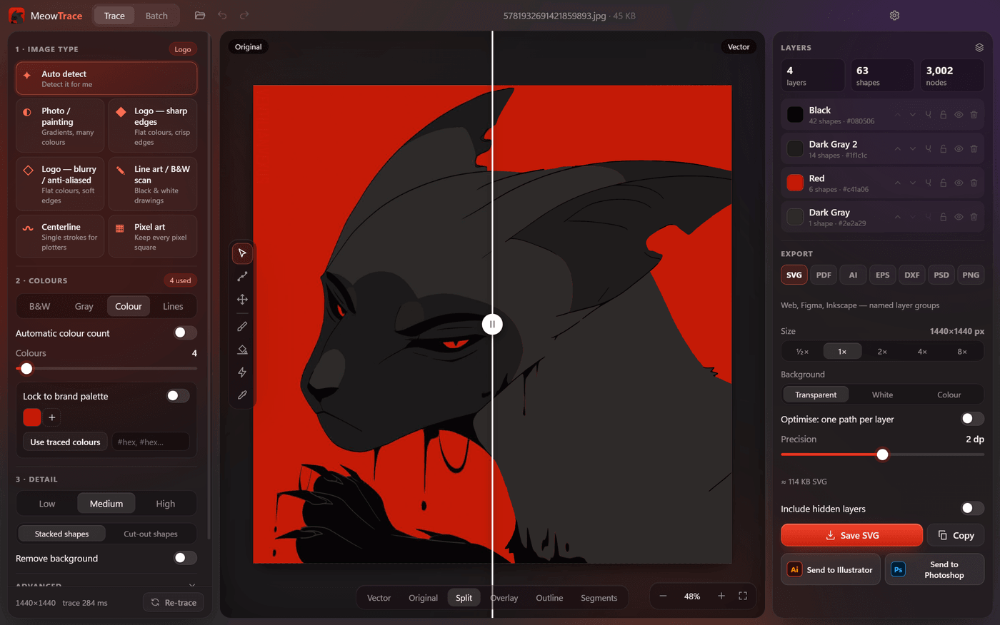
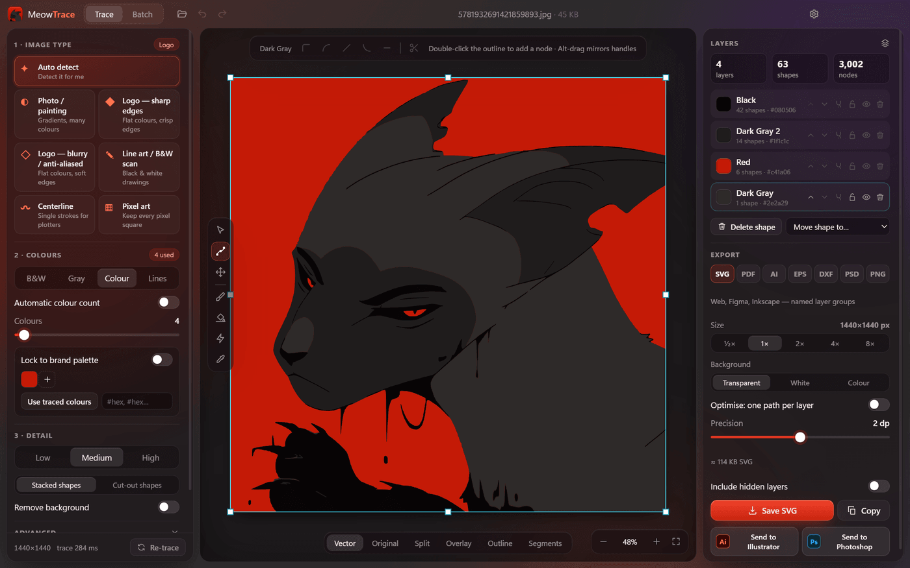

<p align="center"></p>

<h1 align="center">MeowTrace</h1>

<p align="center"><b>Free, open-source bitmap → vector tracer for Windows.</b><br/>
Turn logos, scans, line art, illustrations and photos into clean, layered, editable vectors.<br/>
Offline, no account, MIT licensed.</p>

<p align="center">
  <a href="https://github.com/AminMGM/MeowTrace/releases/latest"><b>Download for Windows</b></a> ·
  <a href="#use">How to use</a> ·
  <a href="#tips-for-the-best-trace">Tips</a> ·
  <a href="#develop">Develop</a>
</p>

<p align="center"></p>

## Why MeowTrace

- **Clean output.** Edges land where they really are. There are no hairline outlines between colours, text keeps its thin strokes, and corners stay sharp.
- **Fixable.** Edit the colour segmentation with a brush before vectorizing, or move individual nodes afterwards.
- **Made for production.** It includes batch mode, brand-palette locking, named layers, and AI / PDF / EPS / DXF / layered PSD export. You can send results straight to Illustrator or Photoshop.
- **Fast and private.** The engine is a small Rust → WebAssembly module that runs on your machine in background workers.

## Features

| | Vector Magic | MeowTrace |
| --- | :---: | :---: |
| Auto-detect image type and colours | ✓ | ✓ |
| B&W, grayscale, colour, custom colour count | ✓ | ✓ |
| Low / medium / high detail | ✓ | ✓ |
| Stacked or cut-out shapes | ✓ | ✓ |
| Curve types (curves or straight lines only), corner control | ✓ | ✓ |
| Edit segmentation (paint, fill, zap, pick, merge, recolour) | ✓ | ✓ |
| Original / vector / split / overlay / outline / segment views | ✓ | ✓ |
| SVG, EPS, PDF, PNG export | ✓ | ✓ |
| **Anti-alias edge snapping**: no outline slivers, thin text kept | – | ✓ |
| **Corner restoration**: sharp tips on stars, triangles, rotated boxes | – | ✓ |
| **Halo-free sharpening** for blurry or upscaled sources | – | ✓ |
| **Centerline tracing** (single strokes, no doubled outlines) | – | ✓ |
| **Pixel-art mode** (exact squares) | – | ✓ |
| **Brand-palette locking** (snap to exact hex values) | – | ✓ |
| **Node editor**: move anchors and handles, add/delete nodes, corner/smooth, line/curve, break apart | – | ✓ |
| **Layer panel**: rename, recolour, reorder, merge, hide, lock, move shapes | – | ✓ |
| **Batch mode**: images or folders in, any formats out, parallel workers | – | ✓ |
| **AI, DXF and layered PSD export**; PDF with real layers | – | ✓ |
| **Send to Illustrator / Photoshop** (+ optional live UXP bridge) | – | ✓ |
| Pre-processing: despeckle, edge-preserving smoothing, 2× upscale | – | ✓ |
| Unlimited undo/redo, presets, copy SVG/PNG to clipboard | – | ✓ |
| Delta auto-updates, offline, no account, open source | – | ✓ |

<p align="center">
  
  
</p>

## Install

Download `MeowTrace-Setup-x.y.z.exe` from [Releases](https://github.com/AminMGM/MeowTrace/releases) and run it. Updates install automatically and are differential: only the changed blocks are downloaded.

## Use

1. **Open** an image with Ctrl+O, drag and drop, Ctrl+V, or *Open with → MeowTrace*. PNG, JPG, WebP, BMP, GIF and AVIF are supported.
2. **Pick the image type**, or leave it on *Auto detect*. Colours and detail re-trace live.
3. **Check** the result in **Split** (3) or **Overlay** (4) view. Drag the split handle to compare.
4. **Fix** what the tracer got wrong:
   - **Segments** view (6): paint (B), fill (G), zap (X) or pick (I) colours.
   - **Vector** view: select (V) or edit nodes (A).
5. **Export**: choose a format and size, then *Save* (Ctrl+S), *Copy* (Ctrl+Shift+C) or *Send to Illustrator / Photoshop*.

**Batch**: switch to the Batch tab and drop images or folders. The current settings are applied to every file.

| Image type | Use it for |
| --- | --- |
| Logo — sharp edges | Flat-colour artwork, icons, screenshots of graphics |
| Logo — blurry / anti-aliased | Soft or compressed logos, JPEGs of flat artwork, text |
| Photo / painting | Gradients and many colours (16 by default) |
| Line art / B&W scan | Ink drawings, signatures, scanned documents |
| Centerline | Single-stroke paths for plotters, cutters and engravers |
| Pixel art | Every pixel becomes an exact square |

## Tips for the best trace

| Problem | Try this |
| --- | --- |
| Thin coloured lines along the borders between shapes | Keep **Snap anti-aliased edges** on (Advanced). Use *Stacked shapes*. If the colour count is set by hand, lower it. |
| Small text breaks up or loses dots | Turn on **Upscale 2× before tracing** (on by default for logos and line art). Set Detail to *High*. |
| Corners come out rounded | Move **Corners** towards *Sharp*. Pick *Logo — sharp edges*. |
| Soft or blurry source | Raise **Sharpen** (0.5–1.0). It steepens edges without adding halos. |
| Noisy scan or JPEG speckles | Use *Despeckle* or *Smooth* under Clean-up. Raise **Ignore specks smaller than**. |
| Two similar colours merged | Drag **Merge similar colours** towards *more colours*, or set the colour count by hand. |

## How it works

The tracing engine is a dependency-free **Rust** crate ([`core-rs`](core-rs)) compiled to a ~210 KB **WebAssembly** module. It runs in Web Workers, so the UI never blocks, and batch jobs run in parallel.

1. **Analyse.** Flat-colour artwork and photos are told apart using only the image's flat areas, so JPEG noise and anti-aliased edges don't push a logo into photo mode.
2. **Segment.** The pipeline runs:
   1. Alpha mask.
   2. Optional denoise and halo-free sharpening.
   3. 2× upscale.
   4. Colour quantization: weighted k-means++ in OKLab, with automatic colour count, palette locking or Otsu thresholding.
   5. **Edge snapping.** Clusters that are only edge blends (thin, and lying between two other colours) are removed. Each of their pixels goes to the colour that covers more than half of it.
   6. Stray-pixel smoothing.
   7. Speckle merging.

   The result is a label map that you can edit by hand.
3. **Vectorize.** Each colour becomes a layer. Outlines are fitted with a Rust implementation of the potrace algorithm: optimal polygon, vertex adjustment, **corner restoration**, corner detection, then Bezier optimisation. Corner restoration replaces bevelled corners with the true meeting point of the two edges. Stacked mode draws each layer over the union of the layers above it, so there are no gaps. Holes stay attached to their shapes.
4. **Centerline.** The pipeline runs Zhang–Suen thinning, builds a skeleton graph with merged junctions, prunes spurs, rebuilds corners, then smooths the Bezier strokes. Stroke widths are measured from a distance transform.

The Electron + React app (TypeScript) handles the editor and the Adobe hand-off. It also contains the exporters (SVG/EPS/PDF/AI/DXF/PSD/PNG), all written from scratch with no dependencies.

A 1440 × 1440 illustration traces in about 1–2 s.

## Develop

Requirements: Node 22+. Rust stable is only needed to rebuild the engine, because the prebuilt `meowtrace_core.wasm` is committed.

```bash
npm install
npm run dev            # app with hot reload
npm test               # TypeScript unit tests (path, nodes, exporters, engine)
npm run core:test      # rebuild the WASM engine + run Rust tests (WASI, no MSVC needed)
npm run build          # typecheck + production build
npm run e2e            # Playwright drives the built app end to end
npm run dist           # NSIS installer in dist/
```

Command-line tracer, using the same engine and settings as the app:

```bash
npm run trace -- input.png output.svg [--kind logo|logo-aa|photo|lineart|centerline|pixel]
                 [--colors N] [--detail low|medium|high] [--upscale] [--remove-bg] [--cutout] [--png preview.png]
```

To release, bump `version` in `package.json`, commit, then `git tag vX.Y.Z && git push --tags`. GitHub Actions then:

- builds the engine from source,
- runs all tests,
- publishes the installer, the blockmap and the `latest.yml` that auto-update needs.

```
core-rs/        Rust tracing engine (crate + WASM ABI)
src/main/       Electron main: files, dialogs, updater, Adobe send, local bridge
src/preload/    IPC bridge
src/renderer/   React UI, worker pool, rasteriser
src/shared/     Engine wrapper, settings, document model, path geometry, exporters
adobe-plugin/   Photoshop UXP panel (live bridge client)
scripts/        Engine build, CLI tracer, end-to-end test, icon generation
```

Issues and pull requests are welcome. Please run `npm test`, `npm run core:test` and `npm run build` before opening a PR.

## License

MIT © AminMGM

<p align="center">Made with ❤ by <a href="https://github.com/AminMGM">AminMGM</a></p>
